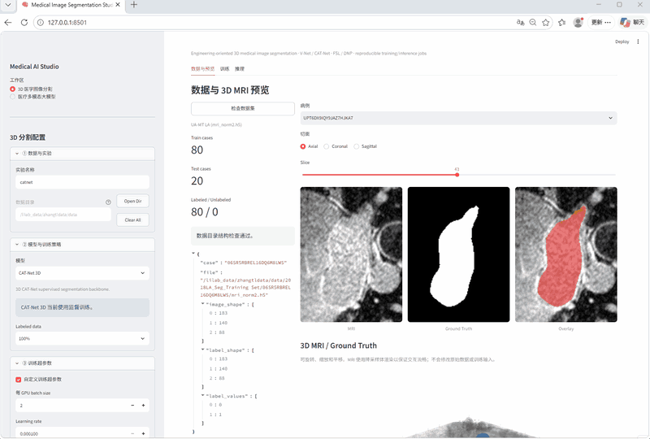
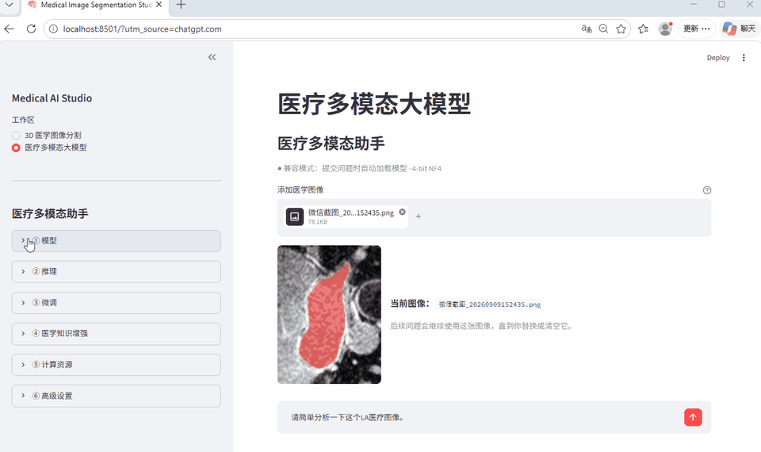

# Medical AI Studio

**Frequency-aware 3D segmentation · Uncertainty-aware semi-supervised learning · Multimodal medical intelligence**

[](https://www.python.org/)
[](https://pytorch.org/)
[](https://streamlit.io/)
[](#33-multimodal-medical-llm)
[](#33-multimodal-medical-llm)

[Visual Results](#2-visual-results) · [Technical Highlights](#3-technical-highlights) · [Quick Start](#4-installation--quick-start) · [References](#5-acknowledgements--references)

## 1. Project Overview

Medical AI Studio brings together **spectral-spatial representation learning, uncertainty-guided segmentation, label-efficient semi-supervised learning, and knowledge-augmented medical vision-language modeling** in a unified research platform.

The segmentation workflow combines Fourier-domain feature extraction, shifted-window Transformer attention and entropy-guided region anchors in a 3D CNN–Transformer architecture. A separate semi-supervised workflow integrates class-wise contrastive learning, bidirectional pseudo-label noise filtering and Neural Process-based distribution alignment. The multimodal workflow supports parameter-efficient fine-tuning, distributed GPU training and image-conditioned Hybrid GraphRAG for evidence-augmented medical question answering.

## 2. Visual Results

### 2.1 3D Medical Image Segmentation

<p align="center">
  
</p>
<p align="center"><em>Ground Truth (left) and Prediction (right). Synchronized 360° rotation for direct comparison of anatomical shape and spatial structure.</em></p>

### 2.2 Medical Multimodal LLM

**Multimodal Medical Conversation**

<p align="center">
  
</p>
<p align="center"><em>Image-conditioned medical question answering through an interactive conversation interface.</em></p>

**GraphRAG-enhanced Medical Question Answering**

<p align="center">
  
</p>
<p align="center"><em>Medical knowledge retrieval and evidence-augmented answer generation with source references.</em></p>

**Parameter-efficient Fine-tuning**

<p align="center">
  
</p>
<p align="center"><em>Configurable LoRA/QLoRA training and GPU resource management.</em></p>

## 3. Technical Highlights

### 3.1 3D Medical Image Segmentation

*Frequency-domain Feature Learning & Uncertainty-guided Transformer*

- **Spectral-spatial feature extraction.** Fourier units transform intermediate features into the frequency domain, learn joint real/imaginary representations through spectral convolution, and reconstruct spatial features using inverse FFT. Combined with volumetric convolution, this provides complementary spectral and spatial representations of anatomical structures.
- **Shifted-window Transformer self-attention.** A 3D convolutional encoder is coupled with plane-wise windowed multi-head self-attention in the decoder. Alternating regular and shifted windows, relative position bias and multi-scale skip connections support local detail preservation and cross-window contextual modeling.
- **Uncertainty-guided region anchors.** An auxiliary region-anchor head predicts coarse region probabilities. Temperature-scaled softmax entropy forms an uncertainty map that modulates bottleneck features, directing representation learning toward ambiguous regions. Region-anchor cross-entropy and segmentation Dice loss provide joint supervision.
- **Multi-scale prediction fusion.** Three decoder prediction heads are averaged to integrate segmentation estimates at different decoder stages.

Implementation: [CAT-Net 3D](ssnet_final/models/catnet3d.py) · [Training objective](ssnet_final/method/objective.py)

### 3.2 Semi-supervised Learning

*Uncertainty-aware Contrastive Learning & Pseudo-label Refinement*

- **Class-wise contrastive learning within an uncertainty-aware framework.** A dual-decoder V-Net learns from labeled and unlabeled volumes using a class-wise feature memory. Correctly classified labeled foreground features populate the memory; learned feature selectors and cosine-distance objectives align labeled and pseudo-labeled embeddings with reliable same-class references.
- **Bidirectional pseudo-label noise filtering.** Each decoder provides sharpened soft pseudo-labels to its peer. An adaptive entropy threshold filters unreliable supervision, while receiver-side uncertainty modulates the weight of accepted cross-branch supervision. This limits the propagation of noisy pseudo-labels in both directions.
- **Probabilistic pseudo-label quality refinement.** A Neural Process head learns latent distributions conditioned on labeled context and pseudo-labeled features. Stochastic latent sampling, supervised Neural Process learning and a Wasserstein-inspired distribution discrepancy encourage alignment between labeled and pseudo-labeled representations, targeting the reliability of pseudo-label supervision.
- **Perturbation-robust regularization.** Virtual adversarial training (VAT) complements cross-branch consistency and contrastive objectives by regularizing predictions under adversarial input perturbations. A scheduled consistency weight gradually introduces auxiliary objectives.

The DNP semi-supervised workflow uses the dual-branch V-Net backbone, independently of the supervised CAT-Net workflow. Entropy masking is applied to mutual supervision rather than directly to the class-wise contrastive loss.

Implementation: [DNP objective](ssnet_final/method/objective.py) · [Contrastive learning](ssnet_final/method/contrastive.py) · [Neural Process](ssnet_final/method/neural_process.py)

### 3.3 Multimodal Medical LLM

*Parameter-efficient Fine-tuning & Multimodal Hybrid GraphRAG*

- **Medical vision-language modeling.** Supports Lingshu-7B (Qwen2.5-VL architecture), MedGemma-4B and compatible custom VLMs for joint image-text understanding and medical question answering.
- **Memory-efficient domain adaptation.** LoRA and 4-bit NF4 QLoRA, configurable adapter targets, gradient checkpointing and adapter-only checkpoints enable parameter-efficient supervised fine-tuning.
- **Distributed training and scalable serving.** Accelerate with PyTorch DDP/NCCL or DeepSpeed ZeRO-2 supports configurable multi-GPU training. vLLM offers data-parallel replicas or tensor-parallel inference; Transformers provides on-demand inference in isolated worker processes.
- **Image-conditioned Hybrid GraphRAG.** The VLM first extracts visual clues from the image and current question. The retrieval pipeline combines the question and visual clues with vector similarity, lexical matching and medical concept co-occurrence graph expansion. A second VLM pass generates an answer conditioned on the original image, question and retrieved evidence.
- **Local knowledge-base construction and evidence-grounded interaction.** Medical documents are processed into searchable chunks, local embeddings and a concept co-occurrence graph. Retrieved evidence and source references are presented through the chat interface. Standard conversation mode supports dialogue history; GraphRAG mode focuses retrieval and generation on the current question to reduce interference from previous answers.

Implementation: [PEFT](foundation_model/peft/) · [Distributed training](foundation_model/distributed/) · [Hybrid GraphRAG](foundation_model/rag/) · [Inference & serving](foundation_model/serving/)

> The retrieval graph represents concept co-occurrence, not a clinically validated medical knowledge graph. These mechanisms describe the implementation and its design objectives, not independently established clinical or benchmark improvements.

## 4. Installation & Quick Start

**Environment:** Linux/Ubuntu, Python 3.10, an NVIDIA CUDA-capable GPU and [uv](https://docs.astral.sh/uv/). The release uses a Linux-targeted dependency lockfile. Native Windows GPU execution has not been validated; a Windows browser can access the application running on a remote Linux server.

From the repository root, install the segmentation environment:

```bash
uv sync --locked
```

For the medical VLM and local GraphRAG components:

```bash
uv sync --locked --extra foundation
```

For optional DeepSpeed and vLLM support:

```bash
uv sync --locked --extra foundation --extra deepspeed --extra serving
```

Start the unified interface:

```bash
uv run --no-sync streamlit run app.py
```

Open the local URL printed by Streamlit. For remote use, prefer an SSH tunnel rather than exposing the interface or its server-side file browser publicly.

### Segmentation data

Prepare a Left Atrium (LA) dataset compatible with the UA-MT directory layout:

```text
<la_data_root>/
├── train.list
├── test.list
└── 2018LA_Seg_Training Set/
    └── <case_id>/
        └── mri_norm2.h5
```

Each HDF5 file contains `image` and `label` arrays. Choose the dataset root, model, labeled-data fraction and GPU resources in the segmentation UI. Use CAT-Net for supervised segmentation or V-Net with DNP for semi-supervised experiments. A 5%-labeled DNP configuration is provided in [`configs/dnp_5pct.json`](configs/dnp_5pct.json).

For CLI experiments, configure the settings in `main.py` and export `MEDICAL_SEG_DATA_ROOT`:

```bash
export MEDICAL_SEG_DATA_ROOT=/path/to/la_data
uv run --no-sync python main.py
```

### Medical VLM and knowledge base

- Select Lingshu-7B, MedGemma-4B or a compatible VLM in the model settings, then provide its local checkpoint directory or supported Hugging Face model ID.
- For fine-tuning, prepare an image-question-answer JSONL dataset. See the [synthetic sample](examples/foundation_dataset_sample.jsonl) and [QLoRA configuration](configs/foundation_medgemma_qlora_multigpu.json).
- For Hybrid GraphRAG, provide your own medical documents and a complete local BGE-compatible embedding model directory (e.g., BGE-small-en-v1.5). Build or import the knowledge base in the UI. The embedding model is loaded locally; scanned PDFs are not OCR-processed.
- Runtime paths can be configured through the UI. See [`.env.example`](.env.example) for optional environment variables; export them in the shell if needed.

### Repository guide

| Component | Location |
| :--- | :--- |
| Segmentation models, semi-supervised objectives and training | [`ssnet_final/`](ssnet_final/) |
| Medical VLM fine-tuning, inference and GraphRAG | [`foundation_model/`](foundation_model/) |
| Unified Streamlit interface | [`studio/`](studio/) |
| Example configurations | [`configs/`](configs/) |
| Synthetic data examples | [`examples/`](examples/) |
| Regression tests | [`tests/`](tests/) |

Run the regression tests after installing the corresponding dependencies:

```bash
uv pip install -r requirements-dev.txt
uv run --no-sync python -m pytest -q
```

## 5. Acknowledgements & References

This project integrates and extends existing research and software components, including CAT-Net, V-Net, DNP/CCAI, FSL, UA-MT, Swin-style attention, Neural Processes, LoRA/QLoRA, Lingshu-7B, MedGemma and BGE embeddings. We acknowledge the original authors and maintainers of these methods, models and tools.

- Segmentation data layout: [UA-MT](https://github.com/yulequan/UA-MT).
- Foundation models and software: [MedGemma](https://huggingface.co/google/medgemma-4b-it), [PEFT](https://github.com/huggingface/peft), [Accelerate](https://github.com/huggingface/accelerate), [vLLM](https://github.com/vllm-project/vllm), [BGE-small-en-v1.5](https://huggingface.co/BAAI/bge-small-en-v1.5).
- Third-party source and model attribution: [`THIRD_PARTY_NOTICES.md`](THIRD_PARTY_NOTICES.md). Confirm original redistribution terms and add the verified CAT-Net, DNP/CCAI and FSL citations before public release. No repository-wide license is asserted here.

**Research use only.** The software is not a validated clinical diagnosis or decision-support system. Model weights, private medical datasets, training artifacts and generated knowledge-base indexes are not included. Publish only visualization assets that are de-identified and explicitly permitted for public redistribution.
